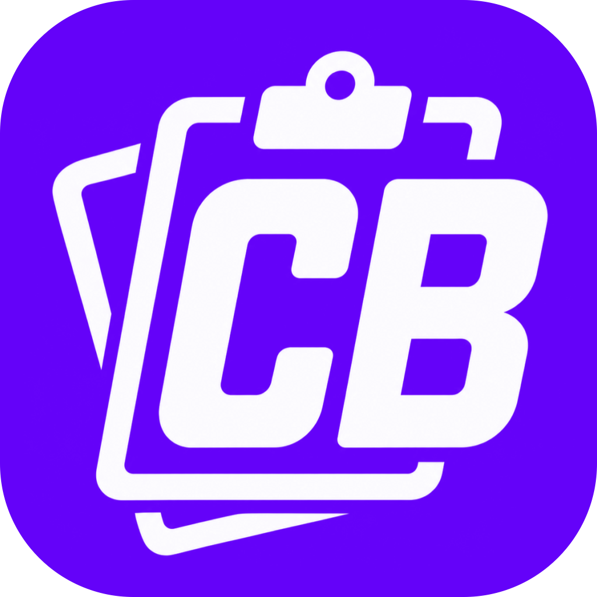

# CopyBlip

A shared clipboard across your Mac, Windows and iPhone devices. Copy on one, paste on another.

Created in [T3 Code](https://t3.codes).

## Status

Early. Text and images, run from a terminal on computers.

| Part | State |
| --- | --- |
| Mac agent | Tested on macOS 27 with the real clipboard |
| Windows agent | Runs on Windows 11; the window and updates aren't tested there yet |
| iPhone app | Runs on a real iPhone; iPhone to Mac confirmed |

## Try it

Build from `desktop/` with `cargo build --release`, then:

```sh
copyblip init          # first device, prints a pairing code
copyblip join          # other computers, asks for the invite link or code
copyblip invite        # shows a QR code to scan with an iPhone
copyblip run           # on every computer
```

For the iPhone, open `ios/CopyBlip.xcodeproj` in Xcode and run it on your phone, then enter the pairing code and follow the [setup guide](docs/iphone-setup.md). Opening the app sends your iPhone clipboard if you copied something new, and otherwise gets the latest copy from your other devices. Its main screen shows the devices you sync with and a Recent list of what you sent and received; tap an item to copy it again.

On a Mac, `desktop/scripts/install-mac-agent.sh` keeps the agent running as a login item with a menu bar icon, and `uninstall-mac-agent.sh` removes it. The log is in `~/Library/Logs/CopyBlip.log`.

For a PC, `desktop/scripts/package-windows.ps1` (on a PC) or `package-windows.sh` (on a Mac) builds a zip. On the PC, run `setup.cmd` from it. It asks whether to join an existing group, using the invite link from any computer in it (**Add a Device** in its window), or to start a new one, and installs the WebView2 runtime if the PC lacks it. CopyBlip then appears in the notification area. Pass `-WithGroup` or `--with-group` to build a zip that's already joined to the building computer's group.

The menu bar and notification area icons show what's connected and what last synced. **Open CopyBlip…** in their menu opens the main window (on Windows, clicking the icon does too), which has:

- **Devices:** every device that has connected, with a green dot for the ones connected now, and a **Recent** list of what this computer sent and received. Click an item to copy it again, as on the iPhone.
- **Add a Device:** a QR code for the iPhone and an invite link for computers.
- **Settings:** pause syncing, open at login, updates, the relay and Tailscale addresses, joining a different group, and the log.

Computers update themselves from signed releases; see [updates](docs/updates.md).

Devices on the same network find each other. For other networks, use Tailscale or the relay; see [away from home](docs/away-from-home.md).

The pairing code is the group's only secret, so treat it like a password. Anyone who has it can read everything the group copies.

On Windows, allow `copyblip` through the firewall when asked. On macOS, choose Always Allow if asked about clipboard access.

## Docs

- [iPhone setup](docs/iphone-setup.md): permissions and how to use it
- [Away from home](docs/away-from-home.md): Tailscale and the relay
- [Updates](docs/updates.md): how computers update, and publishing a release
- [Relay](relay/README.md): deploying it to Cloudflare
- [Findings](docs/findings.md): what's been tested and what iOS allows
- [Protocol](docs/protocol.md): the wire format
